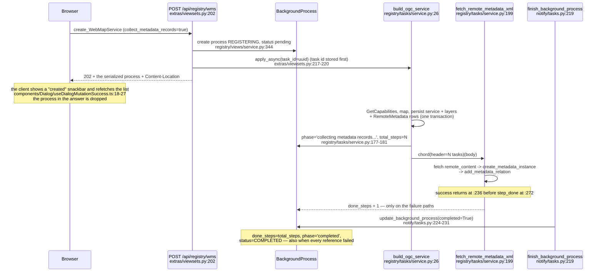

# Registering an OGC service and collecting its linked metadata — audit and design

> Research and design document, **no implementation**. Everything below was read out of
> `origin/master` at `d2a9dc0` (2026-11-11); file and line references are given for every statement.
> `master` has since moved to `af93eaf`; every cited line was re-checked there and still reads the same,
> because the only change to the files in question adds keyword triggers below line 1275.
> The mockups in [`images/metadata-collection/`](images/metadata-collection/README.md) are HTML renderings
> of the real components — no running deployment was involved, see the README.
>
> Status: **findings and proposals**. Items marked **verified** were read in the source; items marked
> **suspicion** need a run to confirm; items marked **proposal** are decisions nobody has taken yet.

## 1. What this covers

The registration of a WMS or WFS runs asynchronously and, when the option
`collect_metadata_records` is on, fetches every metadata document that the GetCapabilities
document references and turns it into a metadata record. Three questions came up repeatedly:

1. What does a user actually learn about that collection — while it runs, and after it ended?
2. When a metadata document fails, where is that visible, and for how long?
3. How does an operator see which metadata belongs to which layer, feature type or service?

## 2. The lifecycle as it is implemented

**verified** — the relevant facts of that picture:

| Fact | Where |
| --- | --- |
| The create endpoint answers 202 with the process, not with the service | `extras/viewsets.py:200-254` |
| The task is published after the process row is committed, with a pre-assigned task id | `extras/viewsets.py:217-220` |
| `collect_metadata_records` defaults to `True` for WMS and WFS, is forced to `False` for CSW | `registry/serializers/service.py:615-618`, `:820`, `registry/views/service.py:1011` |
| The collection is a Celery **chord**: one `fetch_remote_metadata_xml` per `RemoteMetadata` row, body `finish_background_process` | `registry/tasks/service.py:170-183` |
| `total_steps` is set once, to the number of references; the build task's own phases only write `phase` text | `registry/tasks/service.py:177-181`, `notify/tasks.py:124-126` |
| A run in which **every** reference failed still ends `completed` | `notify/tasks.py:224-231`; asserted by `tests/django/notify/test_registration_polling.py:370-410` |
| Failures are stored only as free-text `BackgroundProcessLog` rows of type `WARNING` | `registry/tasks/service.py:245-270` |
| `RemoteMetadata` stores `link`, `remote_content`, `describes` — nothing else | `registry/models/metadata.py:492-513`, `:576-623` |
| `link` is not unique and there is no dedup between registrations | `registry/models/metadata.py:502-504` (a `TODO` says so) |
| The relation to the described object is created only for what the collection produced | `registry/models/metadata.py:571`, `:1217-1246` |
| Harvesting keeps its own bookkeeping (`HarvestedMetadataRelation` with `collecting_state`, phases, logs) — registration does not | `registry/models/harvest.py`, `registry/enums/harvesting.py` |
| No test calls `fetch_remote_metadata_xml` at all | `grep -rn fetch_remote_metadata tests/` → only a comment in `tests/django/notify/test_measurement.py:130` |

## 3. Defects found

| # | Defect | Evidence | Effect today | Class |
| --- | --- | --- | --- | --- |
| A | `case "LayerRemoteMetadata"` appears twice in `fetch_remote_metadata_xml`; the second one — whose body loads `FeatureTypeRemoteMetadata` — can never match | `registry/tasks/service.py:216` and `:222` | Every **WFS feature-type** metadata reference falls into `case _`, returns `None` at `:228-229` with **no log line, no step, no record**. The service ends `completed`. Untested (§2, last row) | **verified bug** |
| B | The success path returns inside the `try`; the only `update_background_process(step_done=True)` sits after the whole `try/except` | `registry/tasks/service.py:236-244` vs `:272-274` | While a healthy collection runs, `done_steps` stays 0 → the Job Center shows 0 % until the last task jumps it to completed. Only failures make the bar move | **verified bug** |
| C | `finish_background_process` completes unconditionally; `update_background_process(completed=True)` forces `done_steps=total_steps` and `status=COMPLETED` | `notify/tasks.py:163-170`, `:224-231` | "Completed" does not mean "everything was collected". The difference is only readable as `WARNING` log lines, which #1208's retention purges | **verified design gap** |
| D | `UnknownMetadataKind` is imported and caught, but never raised anywhere | `registry/tasks/service.py:9`, `:252`; no `raise UnknownMetadataKind` in `registry/` | A document of an unsupported kind lands in the generic `except Exception` instead — same visible effect, dead branch | **verified dead code** |
| E | Both failure branches of the fetch task end without re-raising, so `autoretry_for` never applies to a single document: urllib3's `MaxRetryError` (after three internal retries with `backoff_factor=0.1`) and every other exception - including `NoContent` for a non-200 answer - become a warning | `registry/tasks/service.py:245-270`, `notify/tasks.py:98-103`, `registry/models/metadata.py:517-539`, `registry/exceptions/service.py:11` | A document which is unreachable for a moment is given up for the whole registration, and nothing offers a second attempt | **verified** |
| F | `fetch_remote_content` sends the request **without a timeout**, while the capabilities request of the same flow passes `timeout=15` | `registry/models/metadata.py:530` vs `registry/tasks/service.py:63-65` | One slow or hung metadata endpoint occupies a worker of the `download` queue indefinitely; the `Retry` adapter only covers connection errors, not a silent server | **verified** |
| G | The per-step increment is unbounded (`F("done_steps") + 1`) while a task may be delivered more than once | `notify/tasks.py:157-160` (contrast the capping in `notify/managers.py:144-153`, which this path does not use) | `done_steps` can exceed `total_steps` → `progress` above 100 % | **suspicion** (needs a duplicate-delivery run) |
| H | The answer for `metadata_record=None` still builds a payload: `"id": "None"` and a `"self"` link of the string `"None"` | `registry/tasks/service.py:236-244` | A collection that parsed a document but found no `file_identifier` produces a record reference which is a stringified `None` | **verified** |
| I | A FeatureType never shows its records: `ElementInspection` renders the metadata section for layers only, and `metadataIds` is hardcoded to `[]` for feature types | `Generic/ServiceShow/ElementInspection.tsx:110-113`, `:260-263` | The relation rows exist (`MetadataRelation.feature_type` is filled) but nothing reads them for a WFS element | **verified gap** |
| J | `remove_metadata_relation` is never called from anywhere | `registry/models/metadata.py:1250-1270` (definition), no callers in `grep` | Relations survive a re-registration. Whether they *stack* is not settled by reading: `add_metadata_relation` is a `select_for_update().get_or_create()` over the filled columns plus `is_internal` (`:1241-1245`), so the same record and element cannot produce a second row — a duplicate needs a second record instance for the same identifier, which depends on #982's identity rules | **verified** (the duplicate consequence is a **suspicion** until measured) |
| K | The German label of the create option reads "Metadaten wiederherstellen" ("restore metadata") | `backend/locale/de/LC_MESSAGES/django.po:3129-3130` for `registry/serializers/service.py:617` | The option is named after a different action in the German UI | **verified** |

A–C together are the reason the collection is described as "silent": a WFS operator loses the metadata of
every feature type, and the only clue is that the progress bar never moved.

## 4. Relations: what is stored, what is visible

**verified** — `MetadataRelation` is seven explicit foreign keys plus two provenance fields
(`registry/models/metadata.py:916-1084`): `layer`, `feature_type`, `csw`, `wms`, `wfs`, `dataset_metadata`,
`service_metadata`, with `origin` (`MetadataOriginEnum`: Capabilities, Upload, File System Import, Editor,
Catalogue) and `is_internal`. There is no generic foreign key and no relation "type" — the type is which
column is filled.

Consequences which the UI inherits:

* **verified** — the graph and the tables of the record's *Relations* tab group strictly by those columns
  (`Generic/RecordShow/RecordRelations.tsx:40-51`, `:257-263`). A `ServiceMetadataRecord` that describes a
  dataset (filled via `wms`/`wfs`) is therefore invisible on the dataset record, because the dataset branch
  only asks for `layer`, `featureType` and `csw`.
* **verified** — nothing in the model distinguishes "this record describes that element" from "this record
  refers to that element" (`add_metadata_relation` is called only from `RemoteMetadata.create_metadata_instance`
  with `related_object=self.describes`, `registry/models/metadata.py:571`, `:1217-1246`). So the ISO
  "applies to" direction cannot be shown, and cannot be created by a user through this model.
* **verified** — the record's origin URL and a `MetadataRelation` are the only link back to the `RemoteMetadata`
  row; the link is not unique, and the mapping is by matching `origin=CAPABILITIES` + `origin_url == link`
  (`registry/models/metadata.py:549-554`). Nothing stores "this record came from that reference".
* **verified** — the CSW harvesting path never creates `MetadataRelation` rows at all; a harvested dataset
  record has no element relations (`registry/tasks/harvest.py` — no call of `add_metadata_relation`).
* **verified** — the display is capped at `perPage: 100` and 100 nodes, with the real total only behind an
  info alert (`RecordRelations.tsx:169`, `:133-134`, `:204-207`).

## 5. What an operator cannot find out today

| Question | Answer today |
| --- | --- |
| Is a registration still collecting? | Only "running" vs "completed"; the bar sits at 0 % (defect B) |
| How many references were expected? | `total_steps`, but only after the fan-out; nothing before |
| Which reference produced which record? | Nothing stored; derivable heuristically by `origin_url` matching |
| Which references failed, and why? | Free-text `WARNING` log lines that embed a numeric id, purged by the retention of #1208 |
| Which references were never even attempted (defect A)? | Nothing at all — no log, no state |
| Which metadata describes this feature type? | Not shown (defect I); only the layer branch shows its records |
| Which service-level record describes this dataset record? | Not shown (grouping in the graph/tables, §4) |
| Is a relation from a previous registration still live? | Nothing removes relations (defect J) |

## 6. Proposal: reuse the harvesting bookkeeping instead of inventing a second one

Harvesting already solved the same problem and its shape is documented, translated, tested and rendered.
Registration should adopt it rather than add a parallel mechanism.

| Need | Existing pattern to copy | Where it lives today |
| --- | --- | --- |
| one landing row per expected item, with its outcome and a retry switch | `TemporaryMdMetadataFile`: `requested_url`, `has_import_error`, `import_error`, `re_schedule` | `registry/models/harvest.py:1124-1161`, manager `registry/managers/havesting.py:473-518` |
| the number expected, known **before** the fan-out | `HarvestingJob.total_records` is a stored field, filled from the answer of the catalogue | `registry/models/harvest.py:254`, `:733-748` |
| counters which must not be re-aggregated per poll | stored counters (measured in #1037: annotations on a live run cost 5.85 s cold / 12.2 s worst), answered by index-backed correlated subqueries — a `COUNT FILTER` in front of the whole backlog read the rows of all 411,518 files of one job on every request which rendered its progress | `registry/managers/havesting.py:105-125` (#870, #886), `docs/architecture.md:100-172` |
| a retry of one item which reports into the same run | `re_schedule` makes `save()` clear the error and schedule the import task again — today only the admin action sets it | `registry/models/harvest.py:1177-1202`, `registry/admin/harvest.py:7-13` |
| a transient failure which must not become a terminal one | the import task re-raises what its base promises to retry, „or its autoretry is laundered into a terminal has_import_error" (#895) | `registry/tasks/harvest.py:1186-1190` |
| the per-item table of one run, on the run's screen | `NestedTemporaryMdMetadataFileViewSet` | `registry/urls.py:118-119`, `registry/views/harvesting.py` |
| phases a run goes through | `HarvestingJob.phase` + `HarvestingPhaseStepper` | `registry/tasks/harvest.py`, `frontend/src/components/Resource/HarvestingJob/` |
| run summary screen | `HarvestingRunSummary` + `harvestRun.collectingStates` vocabulary (rendered by `HarvestingRunMissingRecords.tsx:111`) | `frontend/src/components/Resource/HarvestingJob/`, `frontend/src/i18n/en.ts:459-469` |
| a run card on the object's own page | `HarvestingActivityCard` | `frontend/src/components/Resource/CatalogueService/Show/` |
| normalized progress and states for the browser | `OperationStateEnum`, `revision`, `error_summary` | `notify/enums.py`, `notify/managers.py` (#1207) |
| live updates without polling storms | topic websocket + bounded poll fallback | `notify/consumers.py`, Job Center (#1203/#1205/#1206) |

One property of that pattern deserves notice before it is copied, because it decides where the answer to
„which reference produced which record" may live: **a successful import deletes its landing row** —
„Successful imports delete the row. Errors remain for inspection." (`registry/tasks/harvest.py:1174`). The
landing table is a work queue that keeps its failures, not a ledger. The durable statement „this record
describes that element" is what §4 already says it is — `MetadataRelation` — and the landing rows answer
only „what went wrong, and may it be tried again". This is also what the review of this PR decided for
§8 items 2 and 3.

Concretely, as a proposal for a follow-up implementation (each step is independently shippable), shaped
by the review answers of §8:

1. **Fix the two bugs first.** `case "LayerRemoteMetadata"` (A) and the position of `step_done` (B) are two
   one-line changes plus a test that calls `fetch_remote_metadata_xml` with each of the four reference kinds.
   This alone turns a silent total loss for WFS into a visible, correct run.
2. **Give a collecting run a truthful end state** the way harvesting does it: a stored summary the
   serializer exposes (`references_total / stored / failed / skipped`), reported while the run works, so
   the chord body stops answering plain `completed` while references failed (§8 item 1). D9, recorded as
   A on 2026-11-12, settles the presentation as harvesting's own answer — stored COMPLETED plus the
   errors named in the summary, the flag reserved for runs that stand while a human is awaited.
3. **Give the collection a landing row per reference**, in the shape of `TemporaryMdMetadataFile`: the run
   stores how many references it expects before the fan-out, each row keeps the URL, what it describes, an
   error flag, an error text and a re-schedule switch; the counters of the run are answered the way #886
   taught. `RemoteMetadata` is not that table — its own docstring calls it the registration's staging list
   (`registry/models/metadata.py:492-495`) and the review rejected it for this purpose (§8 item 2). Whether
   to reuse `TemporaryMdMetadataFile` itself or write its registration sibling is recorded as D7, option
   A: no new model, one added nullable FK to the collecting process and the constraints that keep the
   two owners apart.
4. **Make transient failures retryable, terminal ones terminal**, in the fetch task the way the import task
   does it (§8 item 3, `registry/tasks/harvest.py:1186-1190`) — which is also the fix of defect E — and
   expose the model's existing retry as an endpoint and a button, not a new mechanism.
5. **Backfill by collecting during an update** instead of migrating: the update path never collects today
   (`collect_metadata_records` appears only in the registration flow — §8 item 5), but an update already maps
   the new capabilities through the configs that declare the reference models, so collecting there reaches
   every existing service without a data migration. The epic's child for this is #1274.
6. **Deduplicate references** by making `link` unique per described object (the `TODO` in
   `registry/models/metadata.py:502-504` already asks for it), so re-registration updates instead of stacking
   — only after #1261 measured whether they actually stack.
7. **Close the relation gap**: let `ElementInspection` use the same data for both element kinds (the branch at
   `:110-113` is the only thing that differs), and show *which* element a record describes rather than only
   "related" — with the existing relation kinds only; RFC #992 owns the vocabulary of relations and the
   review decided against adding "applies to" or "source" here (§8 item 4).
8. **Make the 100-relation cap a facet, not a ceiling**: the tables already filter per group, so a count per
   group plus a link "show all of this group" removes the only place where a user sees a truncated set.

## 7. Mockups

Two current screens (what exists, with the two gaps marked inside the image) and five proposals. All are
rendered from the components themselves; the proposed parts are dashed and tagged.
See [`images/metadata-collection/README.md`](images/metadata-collection/README.md).

| Image | Shows |
| --- | --- |
| `current-registration-jobcenter.png` | after registering a WMS the service page says nothing about the collection; the Job Center row is the only trace, at 0 % during the run and "Completed" after failures |
| `current-featuretype-inspection.png` | a WFS feature type has no metadata section at all, although its relation rows exist |
| `proposed-create-dialog-collect-metadata.png` | the option with wording that states what is collected, what happens on failure, and where to look |
| `proposed-registration-collection-card.png` | one card per registration on the service overview: phases, progress, per-outcome counters |
| `proposed-collection-outcome.png` | the per-reference table on the process screen, with the skipped references of defect A visible |
| `proposed-featuretype-metadata-relations.png` | the element inspection with the metadata section for a feature type, showing which record describes what |
| `proposed-dataset-relationship-graph.png` | the relations graph grouped by what a relation actually means — with the existing relation kinds only, per RFC #992 and the review of this PR |

## 8. Decisions this needs from a human — and what the review answered

All six were asked as the numbered decision request on the epic
([Q1–Q6](https://github.com/mrmap-community/mrmap/issues/1256#issuecomment-6796247548)), answered inline
in [the review of PR #1255](https://github.com/mrmap-community/mrmap/pull/1255) and confirmed on the epic
([the answer comment](https://github.com/mrmap-community/mrmap/issues/1256#issuecomment-6805769801)). The
answers are quoted below because their wording is the decision; the epic's children carry the consequence.
They are **recorded**: `scripts/decisions --issue 1256 record --write` and `register --write` moved them
into the audit trail on 2026-11-11, the register on the epic now reads **Accepted** for D1–D6 with options
B, B, A, A, B, A, and the audit trail carries the six recorded events
([#issuecomment-6805796503](https://github.com/mrmap-community/mrmap/issues/1256#issuecomment-6805796503)).
An answer is a design decision — it is not `agent: approved` and not a pull request approval.

1. **Terminal state.** Should a collection that ended with findings stay `completed` plus a summary, or get a
   distinguishable state? The vocabulary for that state exists: `action_required` is a derived
   `OperationStateEnum` value (#1207) driven by the stored flag `BackgroundProcess.action_required`, set
   through `BackgroundProcess.objects.set_action_required()` — harvesting (`registry/models/harvest.py:668`)
   and an update waiting for its review (`registry/models/update.py:334`) already use it, registration
   does not. The obstacle is the derivation order: `OperationStateEnum.derive()` answers `completed`
   before it looks at the flag (`notify/enums.py:80-90`), so `ACTION_REQUIRED` is only derivable while the
   stored status stays `running` — and the drawer's tabs filter that raw status (`JobCenter/counts.ts:13-17`),
   which puts a flagged run under *Running*, not *Waiting*.
   > **Answered:** „distinguishable state. use equivalent way to harvesting and update"
   > ([r4541817433](https://github.com/mrmap-community/mrmap/pull/1255#discussion_r4541817433)) — so the
   > flag, not a new state. A claim this document shared while working that in — that production never
   > clears the flag — is wrong: harvesting's watchdog clears it when a stalled backlog drains or goes out
   > again (`registry/tasks/harvest.py:799`, `:856`) and the update's reports tie it to the review status
   > (`registry/models/update.py:329-337`). The flag reads as *stands while a human is awaited*; whether a
   > **finished** run with recorded errors uses it at all is the follow-up D9, recorded as A on
   > 2026-11-12: it does not —
   > completed-with-import-errors is how harvesting shows it (`registry/managers/havesting.py:520-528`,
   > `frontend/src/i18n/en.ts:457-458`), and #1277's acknowledge was released to #1104 under that answer.
2. **Where the per-reference outcome lives.** New columns on the four `RemoteMetadata` subclasses, or one
   table per registration run (the `HarvestedMetadataRelation` shape). The first is cheaper, the second keeps
   history across re-registrations.
   > **Answered:** „Maybe we could use the existing TemporaryMDFile model instead of RemoteMetadata model.
   > We only temporary need this model for background import. Final relations between Metadata records and
   > registered resources lives in MetadataRelation model"
   > ([r4541842215](https://github.com/mrmap-community/mrmap/pull/1255#discussion_r4541842215)). The model
   > is `TemporaryMdMetadataFile` (`registry/models/harvest.py:1124-1161`); `RemoteMetadata` is rejected as
   > the outcome store — which its own docstring agrees with: it exists „to store linked iso metadata
   > records **while registration processing**" (`registry/models/metadata.py:492-495`). #1263 carries the
   > remaining question: reuse that model or build its sibling for registration runs.
3. **Retry semantics.** A per-reference "collect now" action needs an endpoint that starts work for one
   reference; today nothing but abort exists (`JobCenterDrawer.tsx:94-103`: no api restarts a decided
   process, `:205` is the only action).
   > **Answered:** „yes we need a retry functionality. TemporaryMDFile model already has this retry in the
   > model implemented." ([r4541851548](https://github.com/mrmap-community/mrmap/pull/1255#discussion_r4541851548))
   > — verified: `re_schedule` makes `save()` clear the error and schedule the import task again
   > (`registry/models/harvest.py:1177-1202`); today only the admin action sets it
   > (`registry/admin/harvest.py:7-13`). So the work is an endpoint and a button, not a mechanism.
4. **The "applies to" direction.** Add a relation kind (and what ISO element it mirrors), or state in the UI
   that MrMap's relations always mean "describes"?
   > **Answered:** „only use the existing relations. See also the open rfc
   > [#992](https://github.com/mrmap-community/mrmap/issues/992) which answers all relations we need."
   > ([r4541861570](https://github.com/mrmap-community/mrmap/pull/1255#discussion_r4541861570)) and, on the
   > graph mockup: „the relation types of applies to and source are not needed currently."
   > ([r4538304447](https://github.com/mrmap-community/mrmap/pull/1255#discussion_r4538304447)) — no new
   > relation kind in this epic; #1268 keeps only what a relation can say with the columns it has.
5. **Backfill.** Existing services have `RemoteMetadata` rows without outcome, and duplicate rows from every
   update. Migrate, or accept and let the next registration rewrite them?
   > **Answered:** „just 'harvest' again inside the update processing. That will backfill all existing
   > services" ([r4541870176](https://github.com/mrmap-community/mrmap/pull/1255#discussion_r4541870176)).
   > Worth knowing before that is built: the update path never collects today.
   > `collect_metadata_records` appears only in the registration flow
   > (`registry/tasks/service.py:34`, `:145`; `registry/views/service.py:352`, `:717`, `:1011`); neither
   > `registry/tasks/update.py` nor `registry/models/update.py` names it or `build_ogc_service`, while the
   > update maps the new capabilities through the same configs that declare the reference models
   > (`registry/mappers/configs/wms130.py:229`, `wfs200.py:202`). The epic's child #1274 takes this.
6. **Naming.** The German label of the option (defect K) and the vocabulary of the outcomes
   (reuse `harvestRun.collectingStates` or a registration-specific set?).
   > **Answered with a correction of the premise:** „i dont understand the question right. The function
   > behind restore metadata is to discard all changes by user and restore to the original harvested
   > content." ([r4541888319](https://github.com/mrmap-community/mrmap/pull/1255#discussion_r4541888319)).
   > That function exists and is described at `registry/serializers/service.py:514` — „the original xml
   > backup file as secured url to restore the xml field". What remains of the finding is smaller than the
   > question suggested and is stated on #1267: in the whole German catalog
   > „Metadaten wiederherstellen" occurs **once**, as the translation of the msgid
   > `collect metadata records` (`backend/locale/de/LC_MESSAGES/django.po:3128-3130`), and the frontend
   > catalog has no such string at all — so the registration dialog offers the restore function's name for
   > the collection option.

## 9. Where this went

The findings are published as **[epic #1256](https://github.com/mrmap-community/mrmap/issues/1256)**,
`slug: metadata-collection`, with thirteen children (#1257–#1268 and #1274) whose sub-issue and
blocking relations are registered on GitHub itself. The two one-line bugs are #1257 and #1258; the transport
bounds are #1260; the bookkeeping clean-up is #1261; everything that reports the outcome reads from #1263.
All nine decision rows are recorded as Accepted in the epic's register — D1–D6 on 2026-11-11, and the
three follow-ups the first answers left — the model shape (D7, #1263), the position in the update (D8,
#1274) and the presentation of a finished run (D9, #1259) — on 2026-11-12, all three as option A: reuse
the model with an added FK, collect inside the update stepper, completed-with-import-errors like
harvesting. The acknowledge action #1277, filed while D9 was still open, was released from the epic under
that answer and adopted by #1104. Nothing in this
document was implemented, and no `agent: approved` was applied.

