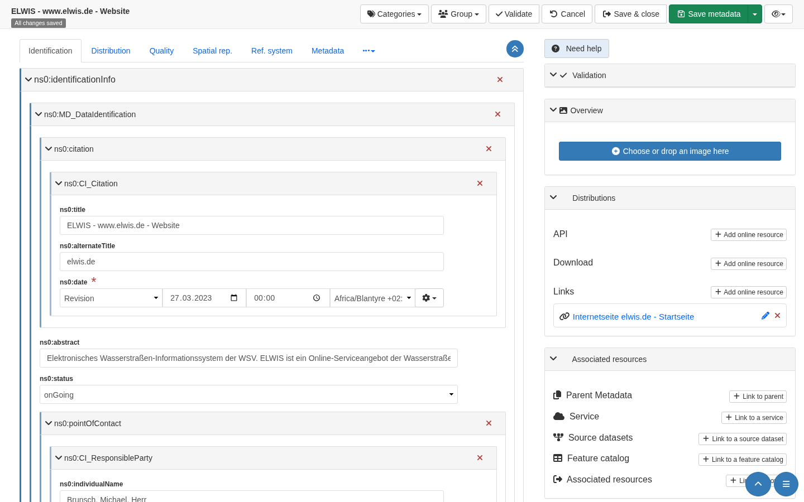
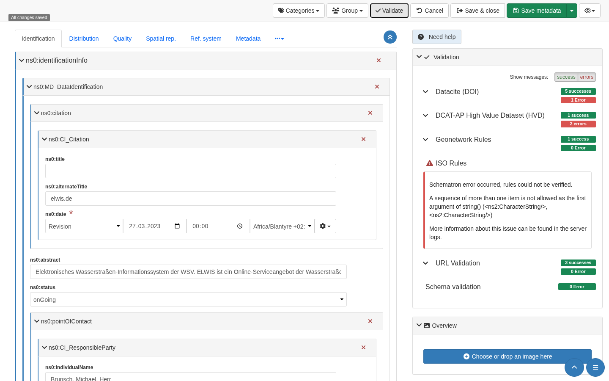
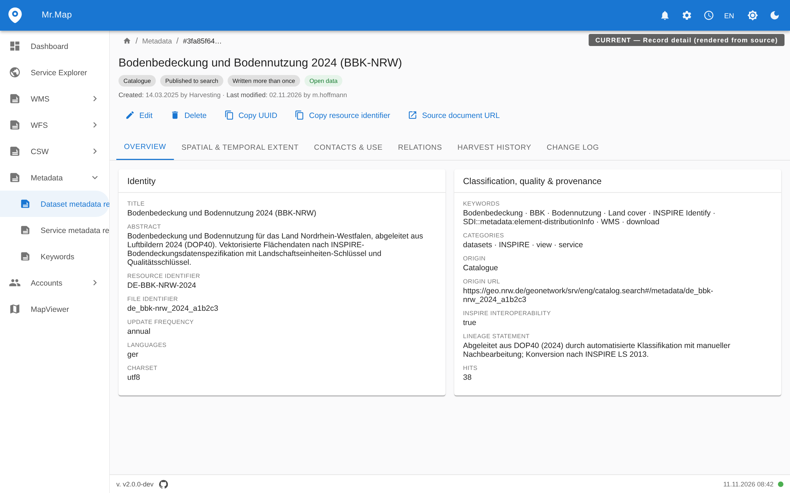
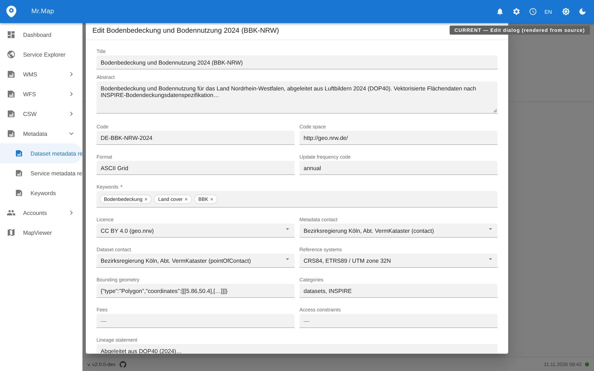

# Metadata editing in MrMap — research, gap analysis and design

Reference material for the epic **metadata-editor** (issue numbers are linked below).
The mockups are proposals, not implemented UI; the evidence grades say what was
actually verified.

## 1. Method and evidence grade

Every statement below carries one of these grades:

| grade | meaning |
| --- | --- |
| **[OBSERVED]** | seen in a running system operated by the author, screenshots under [`images/metadata-editor/`](images/metadata-editor/) |
| **[SOURCE]** | read in the source code of the project (file paths given) |
| **[DOCS]** | from project documentation only, not reproduced |
| **[UNVERIFIED]** | plausible, not confirmed — must be answered before implementation |

What was actually run:

* **GeoNetwork 4.4.12.0** — self-installed in docker with its own Elasticsearch (8.19), fresh
  install. Two real MrMap ISO 19139 fixtures from this repository
  (`backend/tests/django/test_data/iso_metadata/`) were imported through the *Contribute →
  upload* UI; one became uuid `270C4127-5EE3-477D-A3E4-2834649CD57C` and was verified afterwards
  by re-fetching its XML through the editor formatter API.
* **GeoNetwork-UI `metadata-editor` 2.10.2** — served same-origin behind nginx against the same
  catalogue, so the modern editor really talked to the 4.4.12 backend.
* **MrMap `master`** — source analysis of `frontend/src/` and `backend/registry/`. No public MrMap
  deployment was reachable from the machine that produced the images and no local stack was
  started (the agent memory budget was occupied), so the two **CURRENT** images are faithful
  renderings of the implemented components (react-admin v5 + MUI,
  `frontend/src/components/Resource/Generic/RecordShow/`), labelled *CURRENT — rendered from
  source*. All images (CURRENT and PROPOSED) were rendered headlessly at 1440×900; the HTML/CSS
  sources are part of the accompanying PR.

`service.xml` from the fixtures could not be imported into GeoNetwork: it is a CSW `GetRecords`
envelope, not a single record. **[OBSERVED]**

## 2. GeoNetwork today

### 2.1 The classic editor is the `catalog.edit` webapp **[OBSERVED]**

The old `/srv/eng/editor` route no longer exists in 4.4 (`service-not-allowed`). Editing lives in
`…/srv/eng/catalog.edit` under routes `#/metadata/<id>` (record editor), `#/create`, `#/import`,
`#/board`, `#/batchedit`, `#/directory`, `#/accessManager`. Evidence screenshots:
`gn-edit-01-form-top.png`, `gn-edit-04-full.png`, `gn-edit-06-xml-source.png`,
`gn-edit-07-validation.png`, `gn-edit-09-keywords.png`, `gn-edit-10-create.png`,
`gn-edit-12-board.png`, `gn-edit-13-batchedit.png`, `gn-edit-14-import.png`.

Record editor, as observed:

* **Three view modes** in one dropdown: `Simple`, `Full`, `XML`, plus toggles *Tooltips* and
  *More details*. `Full` renders the ISO tree as nested collapsible cards
  (`gmd:identificationInfo > gmd:MD_DataIdentification > gmd:citation > gmd:CI_Citation`) with a
  delete per element and move controls per field; `Simple` is a flat form of the same values;
  `XML` is a line-numbered source editor of the record document.
* **Tabs by ISO area**: Identification · Distribution · Quality · Spatial representation ·
  Reference system · Metadata · (more).
* **Toolbar**: Categories · Group · `Validate` · Cancel · Save & close · `Save metadata`
  (+ dropdown) · preview, with a `Saving … → All changes saved` badge.
* **Right rail**: `Validation` · `Overview` · `Distributions` · `Associated resources`.
* **Validation** reports rule families with success/error counts — observed for an ISO 19139
  record: *Datacite (DOI)*, *DCAT-AP High Value Dataset (HVD)*, *Geonetwork Rules*, *ISO Rules*,
  *URL Validation*, *Schema validation*. The raw XSLT failure text was surfaced to the user
  verbatim („A sequence of more than one item is not allowed as the first argument of
  string() …“), an anti-pattern MrMap should avoid. **[OBSERVED]**

* **Labels showed raw schema names** (`ns0:title`, `ns0:pointOfContact`) for the imported GDI-DE
  profile because the label conversion config does not cover that profile.
  Keyword fields degraded to plain text inputs. Thesaurus-backed keyword entry needs installed
  thesauri plus editor configuration. **[OBSERVED]**, **[SOURCE]** for the mechanism (`EditLib`,
  `config-editor.xml`, XSLT form generation).
* **`#/create` is template-only**: with no templates in the catalogue it renders „There is no
  templates available in the catalog. You should add or import some.“ and no form. **[OBSERVED]**
* **`#/batchedit`** is a 3-step wizard (choose records → define edits → apply changes), scoped to
  records the user may edit. **`#/import`** distinguishes Metadata / Template / Directory entry
  and offers identifier handling *None / Overwrite same UUID / Generate UUID*. **[OBSERVED]**
* **Contacts** are directory entries referenced from the record; the role is injected by editor
  process parameters. **[SOURCE]**, directory screen **[OBSERVED]**.
* **Workflow states** draft / approved / submitted / retired with an editorial board.
  **[SOURCE]** + **[OBSERVED]**. **No editing lock** — last write wins. **[SOURCE]**

### 2.2 GeoNetwork-UI `metadata-editor` (the "simple editor")

* Angular/NgRx, config-driven pages, dashboard, drafts in `localStorage`, `publishToAll`;
  **no client-side validation call**; a heuristic quality score panel; an owner-organisation
  write that is not implemented. **[OBSERVED + SOURCE]**
* **It could not open the imported GDI-DE ISO 19139 records** („No suitable converter found for
  the following document: … `ns0:MD_Metadata` …“), while the classic editor handled them.
  **[OBSERVED]** on 2.10.2. Lesson for MrMap: an editor built on XML→JSON conversion is only as
  wide as its converter — namespace-prefixed, profile-specific 19139 must be first-class test
  input.
* `metadata-converter` **[SOURCE]**: `writeRecord` preserves untouched sections but *regenerates*
  touched ones — unknown content inside a touched section is lost. This is the write-back
  semantics MrMap must decide on explicitly.
* `validate` and `inspire` endpoints exist in the GeoNetwork API but the editor never calls them.
  **[SOURCE]**
* `/create` in metadata-editor 2.10.2 rendered an empty content area in my run; cause not
  investigated. **[OBSERVED]** / **[UNVERIFIED]**

## 3. MrMap today **[SOURCE]**

* Detail screen: `frontend/src/components/Resource/Generic/RecordShow/` — tabs Overview · Spatial
  & temporal extent · Contacts & use · Relations (table + graph) · Harvest history · Change log.
  Genuinely good.
* Editing: `RecordHeader.tsx` opens a `ContextBasedDialog` containing an `EditGuesser` with a
  flat `SimpleForm` and a single save button below the last field. No sections, no validation,
  no access to the XML the CSW serves, no create action in the metadata list at all.
* Backend: `backend/registry/mappers/configs/` holds the ISO 19139 **read-side** mapping configs;
  `extract_mapped_values()` maps XML → model; `xml_backup_file` holds the per-record source
  document; `get_or_create_metadatarecord()` replaces the document wholesale on harvest, gated by
  `date_stamp` / `is_customized`.
* A DB→XML reverse mapper sufficient for editing does not exist. #985 asks for a standards-
  compliant round trip *and* says "build on existing metadata creation/editing API" — which does
  not exist. This epic supplies that foundation.
* Several model fields are `editable=False` (`file_identifier`, `date_stamp`, `origin`,
  `is_broken`); saving through the ORM sets `is_customized=True`.
* Permissions come from guardian object permissions (`canEdit`, `canDelete`) and are already
  answered on the record.
* `is_broken`, `inspire_interop` and the #919 keyword rule show the validation need, but no
  callable validation endpoint exists.

## 4. Gap matrix

| capability | GeoNetwork | MrMap today | decision for this epic |
| --- | --- | --- | --- |
| create a record | template-only `#/create`; fails without templates | none | create wizard: profile + template **or blank** |
| form editing | 3 modes, ISO sections, cardinality from schema | flat schema-generated dialog | full-screen editor, section rail, Simple/Advanced |
| human labels | config-dependent, showed `ns0:title` | OpenAPI-driven labels (better) | keep OpenAPI labels + ISO path as affordance |
| structured keywords | thesaurus registries → `gmx:Anchor` | free text in edit form | thesaurus-backed keyword sets, free text with warning |
| contacts | directory subtemplates + role injection | Contact model, autocomplete | chooser dialog with `CI_RoleCode`, reuse + create-new |
| extent | map/draw editors | GeoJSON text field | bbox/polygon map widget + temporal extent |
| relations | associated panel → process XSLTs | read-only table + graph (#981/#984 family) | editor writes relations through #985's API |
| XML view | line-numbered source editor | download link only | XML source view with explicit write-back semantics |
| validation | schematron families, on save | none callable | profile rules on PUT/PATCH, json:api errors, ISO in v1 (decided) |
| editorial state | draft/approved/submitted/retired + board | published flag + `is_customized` | atomic publishing, no draft state (decided); workflow engine out |
| batch editing | 3-step wizard | none | synchronous frontend bulk edit over a selection, react-admin only (decided) |
| concurrency | none (last write wins) | harvest overwrite gated by `date_stamp` | last-write-wins (decided); harvest gate unchanged |
| locking | none | none | out of scope for v1, stated explicitly |
| permission model | groups/profiles + access manager | guardian `canEdit` | reuse `canEdit`; no new role concept |

## 5. Proposed design (the issues carry the details)

**Write path.** Editing never hand-writes XML from the browser. The editor PATCHes *mapped* model
fields; the backend regenerates the affected elements of `xml_backup_file` through the reverse
mapper, keeps unmapped content verbatim, and bumps `date_stamp` + `is_customized`. One explicit,
validated raw-XML endpoint is the only path that may write unmapped content.

**Profiles are data.** Schema, sections, mandatory/recommended elements, labels, help text and
rule sets belong to a profile record the API can serve, layered on the existing mapper configs.
v1 ships `iso19139-generic`; `iso19139-gdi-de` follows as data.

**Validation runs on the normal CRUD request** (decided in review): MrMap only provides json:api
CRUD endpoints, which validate on PUT/PATCH; the frontend pre-validates from rules the backend
exposes, so editor, batch edit and a future CSW `Transaction` handler share one enforcement path.
A rejected write changes nothing. How rules reach the client (OpenAPI extension vs profile
resource) is still open. No raw XSLT/stack text is surfaced.

**Atomic publishing** (decided): in v1 a validated save *is* the publish — one atomic
transaction, no draft document next to the served one. Concurrency is last-write-wins; the harvest
overwrite gate (`is_customized`/`date_stamp`) is untouched. A draft/conflict UI (per-section
resolve, mockup `proposed-12`) is deferred to a later epic, like template administration.

**Frontend.** New screen family under `frontend/src/components/Resource/Generic/MetadataEditor/`,
built from **React Admin components, extended only where needed — no fully new React components**
(decided in review), reusing the `RecordShow` cards and `SchemaFormFields` — no forked cards. The
editor is a route, not a dialog, so section rail, sticky toolbar and findings rail fit.

## 6. Mockups

CURRENT — rendered from `master` source (no live MrMap demo was reachable):

PROPOSED (labels in the images say "PROPOSED"). The mockups were re-rendered after the review
decisions: single **Save & publish** action everywhere, profile chip *Generic*, validation
findings as save blockers, and `proposed-12` badged **v2 candidate**.

| file | shows |
| --- | --- |
| `proposed-01-editor-simple.png` | editor shell: profile chips, Simple mode, section rail with per-section findings, sticky toolbar (Validate · Save & publish), findings rail |
| `proposed-02-editor-advanced.png` | Advanced mode: ISO element groups with cardinality, keyword sets per thesaurus, add-element |
| `proposed-03-save-rejected.png` | save refused by 2 errors, per-error jump to field, served document untouched |
| `proposed-04-xml-source.png` | XML source view, changed lines marked, write-back rule stated |
| `proposed-05-keyword-picker.png` | thesaurus search grouped by registry, `gmx:Anchor` preview |
| `proposed-06-contact-chooser.png` | pick existing Contact + `CI_RoleCode`, reuse count, create-new |
| `proposed-07-extent-editor.png` | bbox/polygon/GeoJSON modes, bbox fields, temporal extent error inline |
| `proposed-08-relations-editor.png` | relation table with ISO element it writes, origin, add/remove (round trip is #985) |
| `proposed-09-create-record.png` | create wizard: profile + origin + file identifier, start blank; template row disabled (v2) |
| `proposed-10-list.png` | metadata list with serving/validation column, selection, batch edit, create |
| `proposed-11-batch-edit.png` | batch edit one element over a selection; per-record preview, synchronous per-record PATCH |
| `proposed-12-harvest-conflict.png` | **v2 candidate**: harvest-during-edit conflict resolved per section |

## 7. Decisions (review of PR #1238)

The questions this document originally listed as open were answered by the maintainer in the
inline review of this PR; the audit trail is the review threads themselves:

1. **Draft storage** → atomic publishing only in v1 ([r4537429688](https://github.com/mrmap-community/mrmap/pull/1238#discussion_r4537429688)).
2. **Profile registry** → Django model ([r4537433349](https://github.com/mrmap-community/mrmap/pull/1238#discussion_r4537433349)).
3. **Rule sets in v1** → ISO 19139 only ([r4537437616](https://github.com/mrmap-community/mrmap/pull/1238#discussion_r4537437616)).
4. **Batch edit execution** → synchronous, frontend-side, react-admin functionality only ([r4537448116](https://github.com/mrmap-community/mrmap/pull/1238#discussion_r4537448116)).
5. **Templates** → separate epic for v2 ([r4537453636](https://github.com/mrmap-community/mrmap/pull/1238#discussion_r4537453636)).
6. **Concurrency** → last-write-wins ([r4537458987](https://github.com/mrmap-community/mrmap/pull/1238#discussion_r4537458987)).

Cross-cutting: endpoint implementations always follow the json:api default CRUD behaviour
([r4537341050](https://github.com/mrmap-community/mrmap/pull/1238#discussion_r4537341050)) — this
rejected the standalone validate endpoint sketched in earlier drafts of §5 — and frontend features
build on React Admin components ([r4537359916](https://github.com/mrmap-community/mrmap/pull/1238#discussion_r4537359916)).

**Still open:** how validation rules are transported to the frontend (OpenAPI extension vs profile
resource) — investigated on issue #1243.
