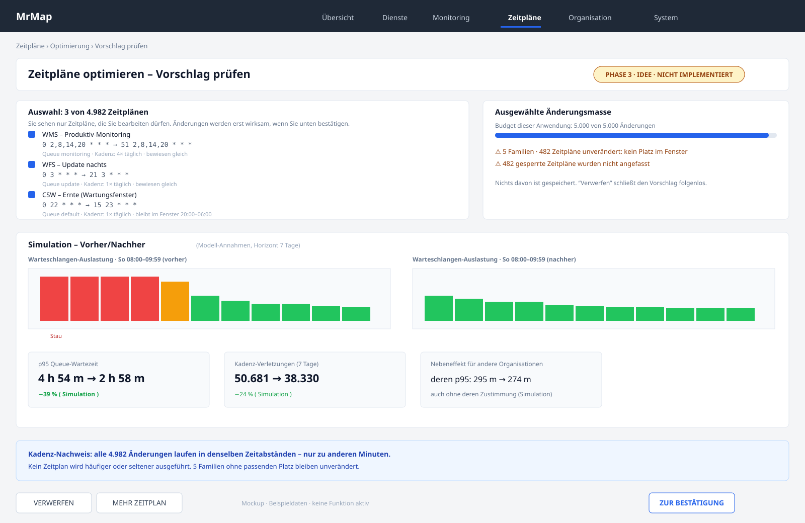
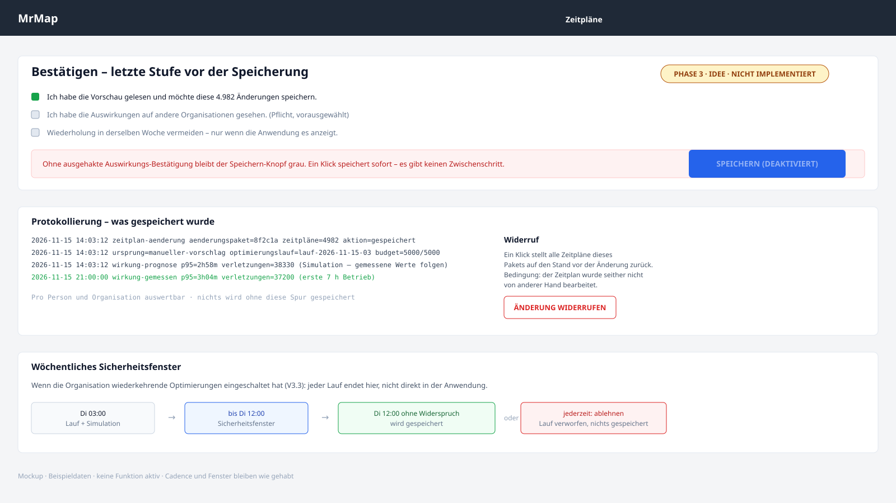

.. _development-schedule-optimization-v3:

============================================================
Schedule optimization V3: opt-in automation (a design spike)
============================================================

.. sidebar:: Issue #1333 · epic #1324

    This page is the design-spike deliverable of issue #1333 - a **future
    V3 concept**. It approves nothing: no automatic schedule change, no
    autoscheduler, no save rejection, no worker topology change. The tools
    described here are host-side spike tools in ``scripts/``; they are not
    part of the deployed application and never touch a database, a broker or
    the network. Offline checks: ``python3
    scripts/test_schedule_optimizer_spike.py`` (no docker, no network, run by
    ``scripts/check_repo_tooling.sh``).

MrMap's scheduling program (epic #1324) ships advice first: the
pre-save preview of #1327, the saved-list warnings of #1332,
the evidence contract of #1325, and later the measured capacity
snapshots of #1330 and #1326 and the
cadence-preserving suggestions of #1328. This document explores the
step the epic deliberately left open: **may an administrator ever let MrMap
not only propose but also apply** cadence-preserving phase shifts across
many authorized schedules - and under which preconditions, authorization
rules and safety mechanics would that be discussable at all.

Status: **design proposal, awaiting the stage gates below and a maintainer
policy decision.** The rejected hard-refusal guard of #1329 stays
rejected; nothing here revives it.

The two product modes must not be conflated
===========================================

The maintainer idea, as captured in #1333, splits into two products
that carry very different risk, and the split is the most important
requirement of this page:

**Mode A - "optimize the settings I selected", once.** An administrator
selects a bounded set of settings they are permitted to change (a list
filter, an org's monitoring schedules, a service's settings), asks for an
optimization, reviews a full before/after comparison, and confirms. One
execution, no timer behind it. This is the preview/save loop of
#1327/#1328 widened from one setting to a set; every change
still passes the existing typed settings API through the ordinary save path
under an explicit human confirmation.

**Mode B - "optimize recurring, automatically".** A tenant or deployment
administrator explicitly enables a recurring optimizer that changes
eligible schedules without a person in the per-change loop. This is a
different product with different failure modes (churn, oscillation,
mis-measured feedback, silent drift) and it is **not enabled by default and
not enabled at all by this document**. Whether any administrator may enable
it, and which schedules may ever be eligible, is a **future maintainer
decision** (decision register below). Every mechanic in this page is
written so that Mode A can be built without pre-committing to Mode B.

Requirements proposal
=====================

Hard constraints (a candidate change that violates one is rejected before
anyone is shown it)
---------------------------------------------------------------------

R01 **Phase only, ever.** A proposed change moves *when* a run happens
inside its natural cycle, never *how often*. The existing cadence semantics
of ``backend/extras/scheduling.py`` (run interval, next expected run, DST
behavior of django-celery-beat) are the authority for what "same cadence"
means, evaluated over a bounded dated horizon exactly as the epic's
measurement rule 6 requires: subtract the old contribution before adding
the new one.

R02 **Occurrence-count proof per schedule.** Every changed schedule carries
a machine-checked proof that its occurrences per full natural calendar unit
(local day / ISO week / calendar month) are identical before and after,
timezone and DST included. No proof, no proposal.

R03 **Windows are hard.** Blackout windows, maintenance windows, legal
reporting windows and each setting's permitted start/end/one-off fields
constrain candidates. An anchored schedule (weekday or day-of-month) never
moves to another anchored day.

R04 **No behavioral drift.** No frequency increase, no disabling, no
skipped run, no new one-off trigger, no silent creation of jobs, no
unintended deadline violations beyond the explicitly displayed expected
wait distribution.

R05 **Ownership and permissions.** The optimizer may only ever consider
settings whose ordinary edit permission the acting administrator holds
(guardian, per #727/#739 conventions). A resource-scoped
user sees per-setting advice, never deployment-wide workload.

R06 **Separate from Beat's own queue scheduling.** Beat and the celery
routers keep deciding what runs when a minute arrives; the optimizer only
edits crontab expressions through the existing typed settings APIs. No
second scheduling engine, and no promise that any "free minute" makes a
task faster (epic measurement rule 7: queue length is not a duration).

Evidence preconditions - the stop rule
--------------------------------------

R07 **Measured or silent.** The optimizer runs only on evidence classes
that justify it: the actual worker occupancy and queue waits measured by
#1330, consumed through the bounded snapshots of #1326, with
per-class sample sizes, windows and timestamps. Demand share covered only by
priors or unknowns is reported as such. Below the evidence threshold the
optimizer must answer **"cannot optimize reliably"** and do nothing - the
spike implements this rule and its test executes it.

R08 **No verified improvement, no change.** Every proposal set is compared
against the baseline simulation before confirmation; a variant that does
not improve the agreed objective by at least the stated threshold is
discarded, and the UI says "no safe improvement found" rather than showing
a coin-flip.

R09 **Immutable before/after snapshot.** An executed change set is stored
with: all old and new cron expressions, the effective timezone, the expected
congestion/wait distribution before and after, the uncertain improvements
with their confidence, affected resources and orgs, and the evidence
timestamp and class that justified the run. This snapshot *is* the rollback
target and the audit object.

Mechanics of applying (Mode A; a later Mode B inherits all of them)
-------------------------------------------------------------------

R10 **Explicit authorized confirmation** per execution. The confirmation
screen shows the full diff, not a summary count.

R11 **Concurrency-safe write.** Each setting is applied with a
compare-and-swap against the version it was proposed from (crontab fields +
enabled + start/end + ``date_changed``); any drift since the proposal
aborts that item - a human editing a schedule in the meantime always wins.

R12 **Exact rollback.** Rollback restores the stored previous expressions
of a change set as one operation, with the same CAS discipline, and stays
available across at least one maintenance cycle.

R13 **Bounded batches.** Per-execution change budget, per-org quotas and a
staged rollout (small batch → observe → larger). The spike below shows why
the budget is a first-class design input rather than a safety afterthought.

R14 **Cooldown and change budget** suppress oscillation and churn: a
schedule changed today is not touched again tomorrow; a recurring Mode B
run needs a separately approved rule, incident response and rollback
controls before it may exist.

R15 **Tenant isolation with honest externality.** Optimization scope is an
administrator's own org (multi-organization deployments), *but* the queues
are shared infrastructure: any phase move changes other orgs' wait
distribution too. The UI must show the impact on non-target orgs, and the
authorization question "who may accept an externality onto another org"
belongs to the decision register, not to an implementation shortcut.

The spike: fixtures, simulation, alternatives, results
======================================================

``scripts/schedule_optimizer_spike.py`` is the executable part of this
page. One command produces a deterministic baseline-vs-recommended
comparison:

.. code-block:: text

    $ python3 scripts/schedule_optimizer_spike.py --fixture full43k --days 7

    schedule_optimizer_spike - design spike for #1333 (fixture numbers are
    rig priors, not deployment facts)
    fixture: full43k  schedules: 43478  horizon: 7 day(s)  worker pool:
    4 slot(s)  timezone: Europe/Berlin
    evidence: telemetry=measured, measured coverage 88.4%

    BASELINE      runs 953106 | p95 wait 4h 54m 14s | mean 1h 46m 48s |
    cadence violations 50681 | peak duty 4/4 | utilization 82%
      queue monitoring      runs 645428  p95  5h 15m 46s  max 6h 06m 13s
      queue update          runs 303842  p95  1h 52m 33s  max 2h 10m 18s
      queue default         runs   2041  p95  1h 00m 16s  max 1h 30m 25s
      queue db-routines     runs   1795  p95      0m 02s  max   14m 43s

    VARIANT constrained  changes 4848 | cadence-proofed 4848, rejected 0
      p95 wait 4h 00m 47s | violations 42608 | utilization 82%
      families refused unchanged: 5 (reasons in the JSON report)

    VARIANT greedy  changes 5000 | cadence-proofed 5000, rejected 0
      p95 wait 2h 58m 41s | violations 38330 | utilization 82%

    STATUS: OPTIMIZED  recommended: greedy
    report digest (sha256): 5375a332...   (stable across re-runs)

The fixture
    The ``full43k`` fixture is the composition #1324 reported for
    one live deployment: 43,478 enabled settings - 13,678 WMS monitoring +
    13,678 WMS update, 8,007 WFS monitoring + 8,007 WFS update, 108 CSW
    settings - routed to the ``monitoring``, ``update`` and ``default``
    queues declared in ``MrMap/celery_queues.py``, over a shared pool of 4
    worker slots (the rig reported ``--concurrency=4``). Worker occupancy
    uses the epic's **historical rig priors** (2.4 s monitoring, 0.6 s
    update) as validation inputs; harvesting occupies the worker for
    minutes and runs in a nightly window; event-driven background work
    arrives independently. None of this is an application default or a
    statement about any real deployment.

The simulation
    FIFO per queue, one shared slot pool served round-robin over the queues
    - the stock worker without ``-Q`` really consumes every declared queue
    (#1040) - driven by the real occurrence moments of every
    crontab in the fixture over the horizon, wall-time based with DST.
    Metrics: p95 queue wait, cadence-deadline violations (a run starting
    later than one own period after enqueue), peak worker duty, change
    count, utilization.

Alternative A - greedy phase spread
    Members of one cadence family (same queue, same pattern) take the
    phase shift that most flattens the convex cost ``sum(load²)`` of their
    queue's per-minute arrival curve; one deterministic pass (each schedule
    is proposed at most once - the spike's no-churn rule), stop at the
    change budget, accept only strictly improving moves.

Alternative B - constrained even phase packing
    A cadence family is packed whole: members are ordered round-robin over
    their organizations (fairness) and given phases spread over the allowed
    shift span of one natural cycle; the family is touched only if **every**
    member passes the window and cadence proofs (all-or-nothing), and the
    whole family fits the remaining change budget.

Results and what they teach (all prior-based, p95 of simulated waits)
    * Both alternatives keep every cadence: the occurrence-count proof (R02)
      rejected **0 of 9,848** proposed changes across both variants - the
      proof fires in the unit suite on a deliberately hand-broken change.
    * Greedy reached p95 2h 59m (−39 % vs baseline 4h 54m) at the full
      budget of 5,000 changes; constrained reached 4h 01m (−18 %) with
      4,848 changes but **refused the five largest families unchanged
      because the budget could not hold them whole** - at 43k scale the
      all-or-nothing family rule and the change budget interact strongly,
      which is an argument for per-family budget policies, not against
      either algorithm.
    * Optimizing only org 0's schedules improved org 0 *and every other
      org* (their p95 295 min → 274 min) because the shared convoy minute
      itself was flattened - direct evidence for R15: scoped optimization is
      not externality-neutral, and a screen that hides this would lie.
    * Even after ideal phase spreading, p95 wait stays in the hours at the
      fixture's ~82 % utilization: **phase shifting redistributes waiting,
      it does not create capacity.** A future UI must show this honestly
      (R06/R07/R08) and must never advertise a "free minute".
    * ``--telemetry missing`` refuses with ``cannot optimize reliably``
      and zero changes (R07), and the improvement threshold yields
      ``NO_CHANGE_without_verified_improvement`` when no variant beats the
      baseline (R08) - both are executed by the test suite.

Reproduce and verify
---------------------------------------------------------------------

.. code-block:: text

    python3 scripts/schedule_optimizer_spike.py --fixture full43k --days 7
    python3 scripts/test_schedule_optimizer_spike.py   # also: check_repo_tooling.sh

The suite covers the cron/DST semantics (spring-gap skip, autumn duplicate
taken once), the shape classifier, the cadence proof (including that it
catches a real frequency change), budget and lock rules, the
window-saturation refusal, a miniature convoy improvement, the stop rule,
determinism by report digest, and the end-to-end 43k run.

UI concept: review, confirm, roll back
======================================

The concept continues the mockup language of the earlier phases (see
``docs/images/scheduling-preview/``); it sits on the existing schedule
lists and the React-Admin edit forms and reuses the #1327 preview contract
per setting. It is OWC-independent: it speaks the scheduling domain
(cron, timezone, cadence proof, evidence class), nothing else.

Review screen - before/after and impact on others
    The administrator selects settings, asks for a proposal, and the screen
    answers four questions in the open: *what changes per setting* (old →
    new expression, effective timezone, proof status), *what it is expected
    to do* (objective metric deltas with evidence class, sample window and
    timestamp, uncertain improvements labeled uncertain), *what it does to
    everyone else* (per-org and per-queue wait deltas, refused families and
    their reasons), and *what it refuses to promise* (no free minute, no
    exact start ETA).

Confirm screen - explicit and specific
    The confirmation repeats the exact count and the exact scope, states
    what a confirmation never does (no frequency change, no disabling, no
    recurring run of the optimizer), and applies with per-item
    compare-and-swap: a schedule a human edited since the proposal aborts
    that item and is shown as skipped.

Audit and rollback
    Each execution is an immutable change set (R09) listed with actor,
    moment, evidence snapshot and the expected-vs-realized effect once
    telemetry comes in; "roll back this execution" restores the previous
    expressions of the whole set, and partial per-item rollback stays
    available.

   Concept only (not implemented, illustrative numbers): Mode A review
   screen - selection, before/after metrics with evidence class, cron diff
   per setting, impact on other schedules and organizations, refused
   families with reasons.

   Concept only: explicit confirmation (one-shot, automation stays off) and
   the audit view with the exact-previous-schedule rollback.

Authorization matrix (proposal)
===============================

.. list-table::
   :header-rows: 1
   :widths: 34 10 12 20 24

   * - Action
     - anonymous
     - resource user
     - org administrator
     - global administrator
   * - See own settings' per-setting advice (#1325/#1327, already planned)
     - no
     - yes
     - yes
     - yes
   * - See capacity snapshots (#1326)
     - no
     - no
     - org-scoped slice
     - full, bounded
   * - Propose a Mode A optimization (simulate only, nothing stored)
     - no
     - no
     - own org's settings
     - all settings they may edit
   * - Confirm a Mode A execution (CAS-checked, audit-logged)
     - no
     - no
     - own org's settings
     - all, and must see the externality row
   * - Accept an externality onto another org's schedules
     - no
     - no
     - no
     - maintainer policy
   * - Enable recurring Mode B
     - no
     - no
     - decision D02 below
     - decision D02 below
   * - Set evidence/cooldown/budget policy
     - no
     - no
     - within defaults
     - yes, audited

Multi-organization constraints carried into any implementation: settings
are proposed/previewed under the same guardian scope as their ordinary
edit (R05); global capacity detail never leaks to resource-scoped users
(epic DoD); an execution names its affected orgs; cross-org optimization
needs the explicit policy row above.

V3 decision register
====================

The numbered design questions an agent cannot answer (normative product
scope) are asked through ``scripts/decisions`` on #1333; the table
is maintained from that audit trail. **No row is Accepted at the time of
writing, and answering them grants neither the** ``agent: approved``
**label nor a pull-request approval.**

.. list-table::
   :header-rows: 1
   :widths: 6 50 14 20

   * - Row
     - Question
     - Status
     - Evidence
   * - D01
     - V3 policy default: proposal/preview-only (Mode A), automation not
       offered at all initially?
     - Awaiting maintainer
     - Q1 on #1333, this spike
   * - D02
     - May a tenant/org or deployment administrator ever enable recurring
       automatic optimization (Mode B)?
     - Awaiting maintainer
     - Q2 on #1333
   * - D03
     - Which schedules are eligible at all (own-org edit permission only?
       harvest excluded? anchored-day schedules excluded?)
     - Awaiting maintainer
     - Q3 on #1333

Follow-up implementation issues are deliberately **not filed** by this
spike: #1333 asks for them only after review of this design, and
only together with the answers above. Candidates the review may turn into
issues: a) the optimizer core as a pure scheduling-domain service over
#1326/#1328 data, b) the proposal/confirmation API + audit model, c) the
review/confirm/rollback screens above, d) window metadata per settings
kind.

What this issue does not approve
================================

Repeating the boundary explicitly, because the issue is a *future design
proposal*: this spike adds no auto-saving behavior, enables no
autoscheduler, rejects no saves, changes no worker topology, and creates no
automatic scheduling. The MVP and phase-2 acceptance criteria of epic
#1324 are unchanged by anything on this page.
