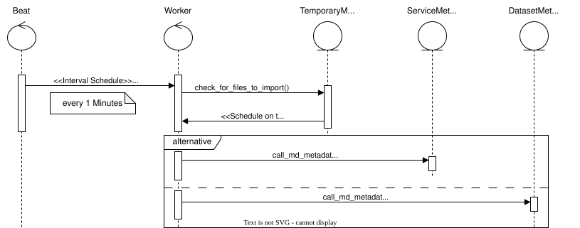

.. _usage:

=====
Usage
=====

Metadata Catalouge
==================
Mr. Map provides a `csw <https://www.ogc.org/standard/cat/>`_ implementation to provide collected metadata.

The csw api is available under ``{schema}://{hostname}/csw``. The usage is described by the ogc specs and is not content of this documentation.

Inspect metadata records
########################

Open a dataset or service metadata record from the explorer or a catalogue's Records tab.
Both record types have the same detail page:

* Overview shows parsed identity, classification, quality and provenance. Choice fields use the
  labels provided by the API schema.
* Spatial and temporal extent shows the parsed geometry, reference systems and time periods.
  Missing extents are stated explicitly.
* Contacts and use shows contact details, licensing and usage terms.
* Relations lists linked layers, feature types or services, including each link's origin and
  whether it was linked by a user. The catalogues that harvested the record are listed separately.
  A graph view shows up to 100 descriptive links; use the paginated tables for the complete list.
* Harvest history shows the outcome and timing of each run and links to the job and catalogue.
* Change log shows recorded field changes and their previous and new values.

Tabs can be linked directly, for example ``DatasetMetadataRecord/<id>/show/relations``.
The header offers edit and delete actions when the backend grants those object permissions.
The "Written more than once" status reflects ``is_customized``; it does not prove that a user
manually corrected the record. The source action opens the recorded origin URL, when available.

Collect Metadata
################

There are much ways Mr. Map collect metadata records which are described in this subsection.

1. Found by ogc service capabilities
~~~~~~~~~~~~~~~~~~~~~~~~~~~~~~~~~~~~
If you register wms or wfs services, Mr. Map will find related metadata records inside the capabilities document and collect them inside background tasks.

2. harvested by other csw's
~~~~~~~~~~~~~~~~~~~~~~~~~~~
Register other csw's as a service resource in Mr. Map. Mr. Map then will harvest them inside background tasks.

3. imported by file system
~~~~~~~~~~~~~~~~~~~~~~~~~~
You can also import metadata records by file system import.

First of all you need the container id of the backend container. Run the following command to list all running containers.

.. code-block:: console

    $ docker ps
    CONTAINER ID   IMAGE                           COMMAND                  CREATED        STATUS             PORTS                                             NAMES
    0dde49351793   mrmap_celery-worker             "/opt/mrmap/.bash_sc…"   18 hours ago   Up About an hour   8001/tcp, 0.0.0.0:3002->5678/tcp                  mrmap-celery-worker-1
    e383a3f0cba2   mrmap_backend                   "/opt/mrmap/.bash_sc…"   19 hours ago   Up About an hour   0.0.0.0:8001->8001/tcp, 0.0.0.0:3001->5678/tcp    backend-dev
    39b1d0412b62   mrmap_celery-beat               "/opt/mrmap/.bash_sc…"   19 hours ago   Up About an hour   8001/tcp                                          mrmap-celery-beat-1
    3ddfaa3a3646   postgis/postgis:15-3.3-alpine   "docker-entrypoint.s…"   20 hours ago   Up About an hour   0.0.0.0:5555->5432/tcp, :::5555->5432/tcp         mrmap-postgis-1
    cbe33a40f90d   redis:7.2.0-alpine              "docker-entrypoint.s…"   24 hours ago   Up About an hour   0.0.0.0:5556->6379/tcp, :::5556->6379/tcp         mrmap-redis-1
    27d72bcacffd   camptocamp/mapserver:7.6        "/docker-entrypoint …"   7 weeks ago    Up About an hour   8080/tcp, 0.0.0.0:8090->80/tcp, :::8090->80/tcp   mrmap-mapserver-1

Then you can simply run ``docker cp ./test.xml e383a3f0cba2:/var/mrmap/import`` or ``docker cp ./test.xml backend-dev:/var/mrmap/import`` to copy files to the container.

If the ``celery-beat`` and ``celery-worker`` container is running, the Mr. Map will find the new files automatically. Not importable files are renamed as ``ignore_{datestamp}_{oldfilename}`` and will be ignored by Mr. Map. 
In this case you need to study the logs to get more information why the file can't be imported by Mr. Map.

Protected services in the map viewer
====================================

When adding a protected WMS, enter its username and password in Add Resource.
The viewer uses these credentials for capabilities and assigns them to operations
of that newly added service on the same origin (scheme, host and port).
Advertised endpoints on other origins require a separate, explicit assignment.
Authenticated requests do not follow redirects; configure the final endpoint directly.
The remote service must permit browser access through CORS, including the configured headers.

Use Manage authentications in the viewer toolbar or a layer's context menu to add
Basic or custom header credentials, update header values, and assign or remove
credentials for each operation. The layer menu limits the operation list to that
layer and its descendants. Removing an assignment permits an unauthenticated
request; deleting a credential retains its assignments and blocks those requests
with a missing-credentials message until they are configured or removed.
GetMap and GetFeatureInfo activation remain independent.

Protected GetFeatureInfo results are fetched with their assigned headers and shown
in the viewer. Remote markup is displayed as text, never executed. Credentials
remain in the viewer session. The JSON context editor omits secret values from
copyable documents, retaining assignments so a recipient can enter their own
credentials. Saving local JSON edits preserves existing session secrets only for
unchanged credential identities, headers and origins.

Supported offerings in the map viewer
=====================================

The map viewer renders exactly one encoding combination of the
`OWS Context GeoJSON profile <https://docs.ogc.org/is/14-055r2/14-055r2.html>`_:
a WMS offering (``http://www.opengis.net/spec/owc-geojson/1.0/req/wms``, accepted
also in its legacy ``owc/1.0`` and ``owc-atom/1.0`` spellings) whose ``GetMap``
and ``GetFeatureInfo`` operations are offered as HTTP ``GET`` with an ``href``.

Everything else in an imported document is kept but not executed:

* offerings of other codes (e.g. WMTS, WFS, WCS) and inline or referenced
  contents (e.g. GeoTIFF, GML) are preserved unchanged through import, editing
  and export, so the document round-trips losslessly;
* operations offered with other methods (e.g. ``POST`` with a request body) are
  not executed;
* the layer tree marks each resource that cannot be rendered with a warning
  indicator naming the unsupported offering code, operation method or content
  type, and the status bar names the resources the document asks to render while
  the supported resources keep rendering.

Adding renderers or executors for further offerings, methods or content types
are separate increments; supporting every OWS offering is not a conformance
requirement of the viewer.
